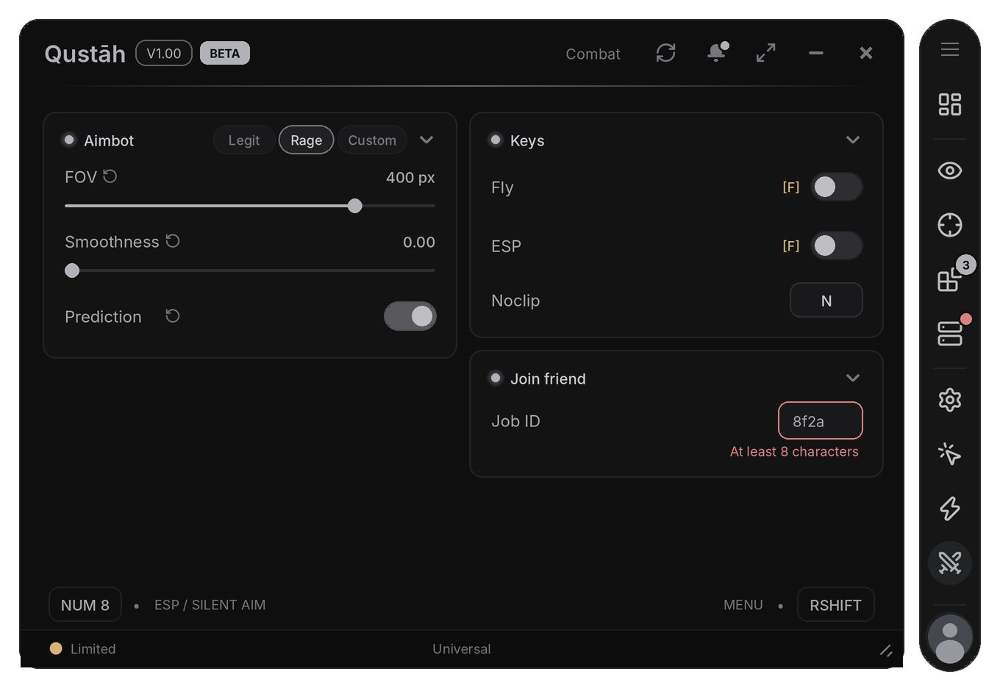
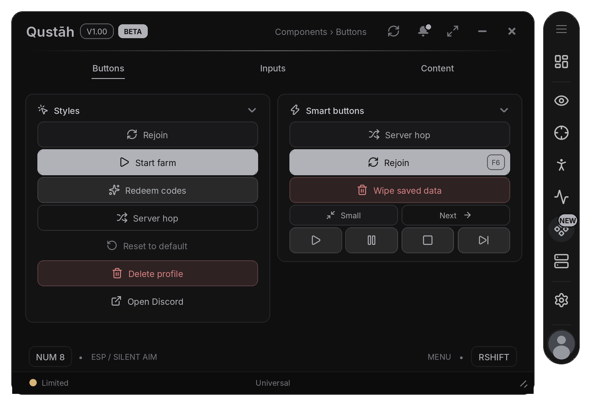
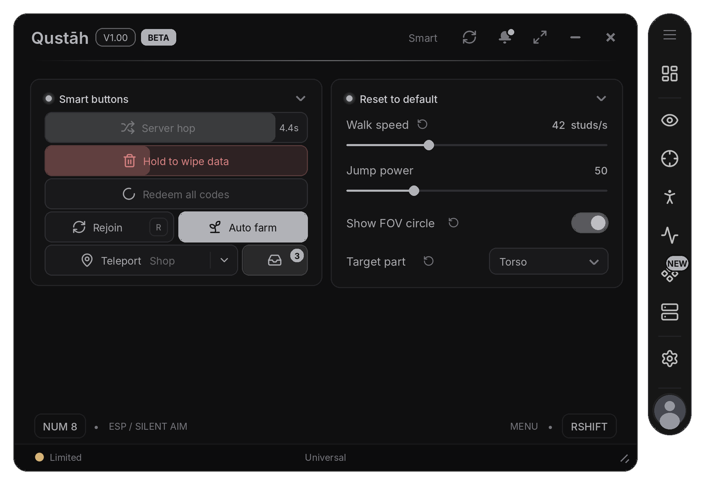
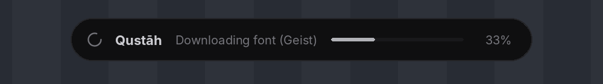
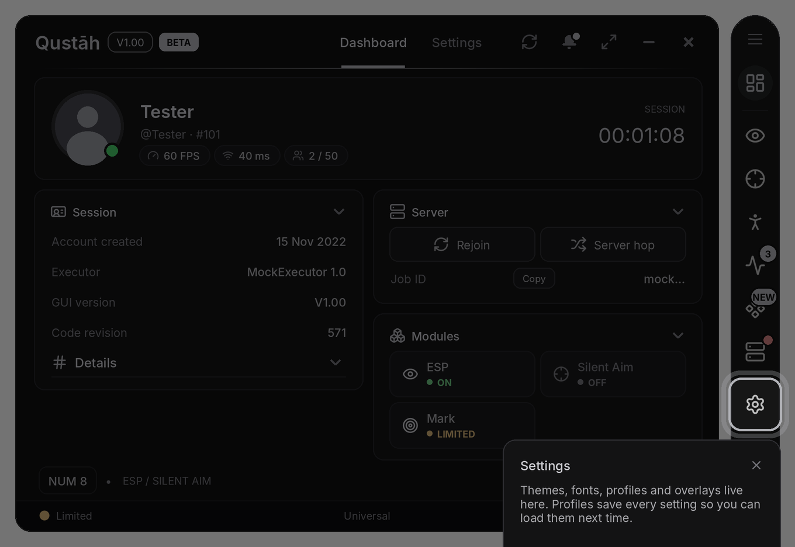

# Qustah UI documentation

[← Back to the README](README.md) · [Example](example.lua)

[Window](#window) · [Tabs, pages and cards](#tabs-pages-and-cards) · [Elements](#elements) · [Flags](#flags) · [Notifications](#notifications) · [Dialogs](#dialogs) · [Configs and profiles](#configs-and-profiles) · [Built-in tabs](#built-in-tabs) · [Overlays](#overlays) · [Themes](#themes) · [Icons](#icons) · [Status, errors and kicks](#status-errors-and-kicks) · [Window extras](#window-extras) · [Key system](#key-system) · [Tour](#tour) · [Changelog](#changelog) · [Links](#links) · [Secure mode](#secure-mode) · [Development](#development)

---

## Window

```lua
local Window = Lib:CreateWindow({ Title = "Qustāh", Version = "V1.00", Folder = "Qustah" })
```

| Option | Default | Description |
|---|---|---|
| `Title`, `Version` | `"Qustah UI"`, `""` | the title and the version badge next to it |
| `Icon` | — | logo before the title (icon name, asset id or web image) |
| `Tags` | — | chips next to the title: `{ "BETA", { Text = "PRO", Color = Color3 } }` |
| `Folder` | the title | folder for files (profiles, window position, themes) |
| `Size`, `MinSize`, `MaxSize` | `540×390` | `Vector2`; resized from the corner, scaled down on small screens |
| `ToggleKey` | `RightShift` | key that opens and closes the menu |
| `Accent` | Qustah grey | `Color3` |
| `Footer` | the game's name | text in the middle of the footer |
| `KeyHints` | `true` | the `MENU • RSHIFT` badge in the footer bar |
| `CloseAction` | `"Hide"` | the X button: `"Hide"` hides the menu and shows how to reopen it, `"Destroy"` unloads everything |
| `SaveWindow` | `true` | remember position, size and floating panels |
| `PerGame` | `false` | `"Game"` / `"Place"`: separate profiles for each game |
| `UnlockMouse` | `true` | frees the mouse while the menu is open (shift lock, first person) |
| `Profile`, `Anonymous` | `true`, `false` | the avatar button in the dock; start in anonymous mode |
| `FullscreenButton` | `false` | a fullscreen button in the header (double click on the header still goes fullscreen) |
| `NotificationHistory` | `true` | the bell in the header (notification history) |
| `Background`, `BackgroundTransparency` | — | background image, window transparency |
| `LiveBackground`, `AccentGlow` | `false` | slow accent light drifting behind the content; window edge that pulses in the accent colour |
| `Welcome` | `true` | "Signed in as" toast the first time an account opens the menu |
| `AutoFlags` | `false` | gives elements without a Flag one based on their name (see [Flags](#flags)) |
| `ResetButtons` | `true` | the small reset icon after a changed element's title (see [Flags](#flags)) |
| `Font` | `"Gotham"` | starting font, e.g. `"Inter"`, or a list such as `{ "Geist", "Inter" }` (see [Themes](#themes)) |
| `OnePickerOpen` | `true` | opening a colour panel closes the other open one (see [ColorPicker](#colorpicker-gradient-and-swatches)) |
| `Debug` | `false` | a notification for every new error |
| `KickLog`, `Rejoin`, `RejoinDelay` | `true`, `false`, `2` | log kicks; rejoin after a kick |
| `Secure` | `false` | [Secure mode](#secure-mode) |
| `Blur`, `BlurSize` | `false`, `12` | blur the game behind the open menu |
| `Scale` | `1` | the whole menu bigger / smaller (0.6 – 1.5); Settings › Behaviour › UI scale offers 80 / 100 / 120 % |
| `MobileButton` | `"Auto"` | reopen button while the menu is hidden: `"Auto"` = phones / tablets, `true`, `false` |
| `Sounds` | `false` | soft UI clicks (`Lib.Sounds`) |
| `KeySystem` | — | key screen before the window opens ([Key system](#key-system)) |
| `Changelog` | — | "What's new" dialog, shown once per version ([Changelog](#changelog)) |
| `Tour`, `TourDelay` | `false`, `2.5` | first-run guide, once per account: `true` for the built-in steps or your own list ([Tour](#tour)) |
| `OnClose` | — | function that runs when the window is destroyed |

| Method | |
|---|---|
| `Window:Tab({ Title, Icon, Divider, Header, Build })` | adds a tab to the dock (`Build`: see below) |
| `Window:SetUIScale(1.1)`, `:GetUIScale()` | menu size; smaller screens still fit |
| `Window:SetVisible(bool)`, `:Toggle()`, `:Minimize()` | show, hide, or fold to the title bar |
| `Window:SetToggleKey(key)` | changes the menu key (the badge and Settings update too) |
| `Window:SelectTab(tab or "Title")` | opens a tab |
| `Window:SetFooter(text)`, `:SetStatus(text, color)` | footer texts |
| `Window:Notify(cfg)`, `:Toast(cfg)` | a notification, or a small pill notification |
| `Window:Destroy()` | closes everything (`OnClose` runs) |

## Tabs, pages and cards

```lua
local Visuals    = Window:Tab({ Title = "Visuals", Icon = "eye" })
local Overview   = Visuals:Page("Overview")                -- a page strip appears once a tab has 2+ pages
local Appearance = Visuals:Page("Appearance", { Columns = 1 })

local Left  = Overview:Card({ Title = "General" })          -- cards alternate between the left and right columns
local Right = Overview:Card({ Title = "Colors", Side = "Right", Icon = "palette", Desc = "Card description" })
local Top   = Overview:Card({ Title = "Server", Wide = true })   -- spans both columns, sits at the top
local Under = Overview:Card({ Title = "Notes", Wide = "Bottom" }) -- spans both columns, under them
Overview:MatchHeights(Left, Right)                              -- side-by-side cards as tall as the tallest
```

**Tabs**
- `Icon` is shown in the dock.
- `Divider = true` puts a line above the tab.
- `Header = true` also shows the tab as a text tab in the header.
- `Tab:Card()` adds a card to the first page without creating one.
- `tab:SetHidden(true)` (or `Window:Tab({ Hidden = true })`) takes the icon out of the dock without leaving a gap; the tab still opens from code (`Select`, `Window:SelectTab`).
- `tab:SetBadge(3)` puts a number on the tab's dock icon (`"NEW"`, `true` for a dot, `0` / `nil` hides it; a second argument picks the colour, e.g. `"danger"`).
- `tab:SetActive(true)` puts a small green dot at the bottom corner of the dock icon (something in this tab is running); `false` hides it.
- `Build = function(tab) ... end`: the tab's content is made later, so a big script starts faster. It builds itself 1.5 s after start (its key binds work without opening it); `BuildDelay = false` waits until the tab is opened. `Window:BuildAll()` builds every lazy tab now.

**Pages**
- `Columns = 1` gives a single column.
- When the window is narrower than 470 px, the two columns stack.
- `Warning = "..."` or `page:Warning("text", { Title, Icon, Level = "warning" | "danger" | "info" })` puts a banner at the top of the page.

**Cards**
- `card:HeaderSwitch({ Title = "Debug", Flag, Default, Callback })` puts a small switch in the card's title row.
- The arrow in the header folds the card. `Collapsible = false` removes the arrow, `Collapsed = true` starts folded, and the folded state is remembered.
- The title starts with an accent dot; `Icon = "name"` puts an icon there instead. `Dot = false` leaves the plain title, and `CreateWindow({ CardDots = false })` does that for every card without an icon.
- Methods: `card:SetCollapsed(bool)`, `card:SetTitle()`, `card:SetDesc()`, `card:SetVisible()`.
- A card with nothing visible in it shows "Nothing here" (`Empty = "your text"`, or `Empty = false`).

Layout inside a card:

```lua
local tabs = Card:Tabs({ "Players", "Filters" })          -- capsule switcher in the header, one section each
tabs.Players:Toggle({ Title = "Ignore friends" })

local advanced = Card:Section({ Title = "Advanced", Icon = "settings-2", Opened = false })  -- collapsible section
advanced:Slider({ Title = "Delay", Min = 0, Max = 1, Step = 0.05 })

local row = Card:Row()                                     -- children sit side by side (equal widths, or Widths = { 2, 1 })
row:Button({ Title = "Start", Icon = "play" })
row:Button({ Title = "Stop", Icon = "square" })

local group = Card:Group({ Title = "Server" })             -- boxed group
group:Info({ Title = "Region", Value = "EU" })
```

**Presets.** Chips in the card header that set several flags at once. The chip that matches the current values lights up by itself; once you change something by hand, **Custom** lights up instead. Going from Custom to a preset remembers your values, so clicking Custom brings them back.

<p align="center"></p>

```lua
local presets = Aim:Presets({
    { "Legit", { fov = 80,  smooth = 0.6, prediction = false } },
    { "Rage",  { fov = 400, smooth = 0,   prediction = true } },
}, { Callback = function(name) print(name) end })   -- Custom = false hides the Custom chip

presets:Select("Rage")    presets:Get()    presets:Add("Off", { fov = 0 })
```

---

## Elements

Each element is a method of a card, or of a Section, Row, Group or Tabs section: `card:Toggle({ ... })`.

**Common options**
- `Title`, `Desc`, `Flag`, `Callback`
- `Icon`: an icon left of the title
- `Help`: a small (i) icon in the row; hovering or tapping it shows this text
- `Risky`: red title; if you pass text, it becomes the (i) hint
- `Tooltip`: text shown next to the mouse after a short hover
- `DependsOn`: follow another flag (see below)
- `Locked`, `LockedTitle`
- `Reset = false`: no reset icon for this element (see [Flags](#flags))

**Common methods:**

| Method | |
|---|---|
| `:Set(value)`, `:Get()` | the value (Set also runs the callback) |
| `:OnChanged(fn)` | extra listener |
| `:Lock("reason")`, `:Unlock()` | locks the element; the reason replaces the description, or sits over the control with a lock icon if there is no description |
| `:SetTitle(text)`, `:SetDesc(text)`, `:SetVisible(bool)` | |
| `:MoveUp()`, `:MoveDown()`, `:MoveTo(index)`, `:GetIndex()` | position inside the card |
| `:Flash("success" \| "danger" \| "accent")` | a short tint behind the row |
| `:SetTooltip(text)` | |
| `:ResetToDefault()` | puts the starting value back (elements with a Flag) |
| `:Remove()` / `:Destroy()` | removes the element and its flag |

**DependsOn:** an element (or a whole card / section) follows other flags and updates by itself.

```lua
Card:Toggle({ Title = "Prediction", DependsOn = "silentAim" })                     -- locked until silentAim is on
Card:Slider({ Title = "Head offset", DependsOn = { Flag = "aimPart", Value = "Head" } })
Card:Toggle({ Title = "Legit mode", DependsOn = { Flag = "rage", Not = true, Mode = "Hide" } })   -- "Hide" instead of lock
Card:Button({ Title = "Farm", DependsOn = function(flags) return flags.esp and flags.range > 500 end })
Page:Card({ Title = "Rage settings", DependsOn = "rage" })                            -- the card shows only while rage is on
```

The lock reason is written for you ("Turn on Silent Aim first"); `Reason = "..."` sets your own. A lock you put on yourself is kept.

If a callback errors:
- the element flashes red;
- its title reads "Error · see Settings › Info" for 2 seconds;
- the error is listed in Settings › Info;
- the UI keeps working.

### Toggle and Checkbox

```lua
local esp = Card:Toggle({
    Title = "ESP", Desc = "Show player ESP", Flag = "esp", Default = true,
    Bindable = true,                          -- right-click the row to bind a key (Backspace clears, Esc cancels)
    Bind = Enum.KeyCode.F,                    -- starting key
    BindMode = "Toggle",                      -- "Hold": on only while the key is held
    Marker = true, Badge = "NEW",             -- accent bar on the left, chip after the title
    Callback = function(on) end,
})
esp:SetBind(Enum.KeyCode.G)

Card:Checkbox({ Title = "Visible only", Flag = "visibleOnly", Default = false, Callback = function(on) end })  -- a plain tick box
```

### Slider and Range

```lua
Card:Slider({
    Title = "FOV", Flag = "fov", Min = 10, Max = 600, Default = 120, Step = 1, Suffix = "px",
    Icons = { From = "minus", To = "plus" },  -- icons at the ends; a click moves one step
    Bubble = true,                            -- value bubble while dragging
    Callback = function(value, dragging)      -- dragging: true while held, then false once with the final value
        if not dragging then rebuildCircle(value) end
    end,
})
Card:Range({ Title = "Health filter", Flag = "hp", Min = 0, Max = 100, Default = { 20, 80 }, MinGap = 5 })  -- value is { low, high }
```

Click the value to type a number. `slider:SetRange(min, max)`.

```lua
Card:Stepper({ Title = "Clicks per second", Flag = "cps", Min = 1, Max = 20, Step = 1, Default = 8, Suffix = "" })
```

`[-] 8 [+]`: exact numbers without a slider. Hold a button to repeat (it speeds up); click the number to type one.

### Dropdown, Segment and Radio

```lua
Card:Dropdown({ Title = "Font", Flag = "font", Options = { "Gotham", "Code", "Arcade" }, Default = "Gotham" })

Card:Dropdown({ Title = "Show", Flag = "parts", Multi = true, Options = { "Name", "Health", "Distance" }, Default = { "Name" } })
-- (a multi box shows as many names as fit, then "+N": "Name, Health +2")

Card:Dropdown({ Title = "Target", Flag = "priority", AllowNone = true, Options = {
    { Title = "Closest",   Icon = "footprints", Desc = "Nearest to you" },
    { Title = "Crosshair", Icon = "crosshair" },
    { Title = "Bounty",    Icon = "gem", Locked = true },
} })

Card:Dropdown({ Title = "Mode", Options = { pvp = "PvP mode", farm = "Auto farm" } })   -- the value is the key ("pvp")

Card:Segment({ Title = "Aim part", Flag = "aimPart", Options = { "Head", "Body", "Closest" }, Default = "Head" })

Card:Radio({ Title = "Priority", Flag = "priority", Options = {         -- every option visible, one chosen
    "Closest",
    { Title = "Lowest HP", Value = "hp", Desc = "Finish weak targets" },
    { Title = "Bounty", Locked = true },
} })
```

- Lists with more than 8 options get a search box (`Search = true/false`).
- Thousands of options stay fast: the list is drawn in chunks.
- In multi lists you can drag over options to select them (`DragSelect = false` turns it off).
- `:SetOptions(list, keepValue)` (`:Refresh(list)` is the same, keeping the value), `:GetLabel()`.

### Keybind

```lua
Card:Keybind({ Title = "Aim key", Flag = "aimKey", Default = Enum.KeyCode.Q, Pressed = function(key) end })

Card:Keybind({ Title = "Mark", Chord = true,               -- modifier + key or mouse button (CTRL + M1)
    Default = { Enum.KeyCode.LeftControl, Enum.UserInputType.MouseButton1 } })

Card:Keybind({ Title = "Hold to aim", Default = Enum.KeyCode.E, Mode = "Hold",
    Pressed = function(down) aiming = down end })          -- true on press, false on release
```

Click the badge, then press a key (Backspace clears, Esc cancels). `Callback` runs when the key changes. `Pressed` runs on every press.

**Key conflicts.** When two binds (toggles, buttons, keybinds, key hints) use the same key, or one uses the menu key, their key tags turn yellow and hovering one says what else uses the key. A conflict made after the start also shows a notification. `Window:GetKeyConflicts()` returns `{ [key] = { titles } }`.

### ColorPicker, Gradient and Swatches

```lua
Card:ColorPicker({ Title = "Fill", Flag = "fill", Default = Color3.fromRGB(215, 120, 120),
    Rainbow = false, RainbowSpeed = 5,       -- there is also a Rainbow button inside
    Apply = false,                           -- true: changes only apply when Apply is pressed
    Alpha = true, Transparency = 0.3,        -- transparency bar
    Callback = function(color, transparency) end })

Card:Gradient({ Title = "Chams", Flag = "chams", Default = { Color3.new(1, 0, 0), Color3.new(0, 0, 1) },
    Callback = function(sequence, a, b) end })   -- :GetSequence()

Card:Swatches({ Title = "Name color", Flag = "nameColor", Default = "Blue",
    Callback = function(color, name) end })      -- without Colors = { { "Blue", Color3 }, ... } it uses 8 presets
Card:Swatches({ Title = "Accent", Style = "Dots", Custom = function(open) end })   -- one row of round dots, the last for "any colour"
```

The picker has a saturation square, a hue bar, a HEX box, Random and Rainbow. It also accepts `"RRGGBB"` strings.

Only one colour panel is open at a time: opening a picker or gradient closes the one that was open (a gradient's own Start / End pickers open inside it). `picker:SetOpen(true)` opens one from code. `CreateWindow({ OnePickerOpen = false })` lets several stay open.

### Input, TextArea and ActionInput

```lua
Card:Input({ Title = "Target", Flag = "target", Placeholder = "player name", Numeric = false,
    Finished = true,                          -- false: the callback runs on every keystroke
    Callback = function(text) end })

Card:Input({ Title = "Job ID", Flag = "job", Placeholder = "paste id",
    Validate = function(text)                 -- checked while typing: true = green edge, false = red edge + message
        if text == "" then return nil end
        return #text >= 8, #text >= 8 and "Looks good" or "At least 8 characters"
    end })                                    -- a wrong value is not taken: the flag keeps the last good one

Card:TextArea({ Title = "Auto chat message", Flag = "chat", Placeholder = "gg", Height = 80, MaxLength = 200,
    Callback = function(text) end })         -- multi-line; a "12 / 200" counter with MaxLength

Card:ActionInput({ Icon = "plus", Placeholder = "Profile name", Button = "Create",
    Validate = function(text)                 -- live hint: ok = green, false = red
        if text == "" then return nil end
        return #text <= 20, #text <= 20 and "Looks good" or "Too long"
    end,
    Callback = function(text) end })          -- on the button or Enter
```

`input:SetPlaceholder(text)` changes the grey hint of an Input. `actionInput:Run()` presses an ActionInput's button from code.

### Button

<p align="center"></p>

```lua
Card:Button({ Title = "Rejoin", Icon = "refresh-cw", Callback = function() end })
Card:Button({ Title = "Server hop", Confirm = true, Callback = hop })        -- asks for a second click within 2 s
Card:Button({ Title = "Delete all", Risky = true, Confirm = "Sure?", Callback = wipe })
```

**Styles.** `Style` picks the look. Every style follows the theme and the accent colour.

| Style | Look | Good for |
| --- | --- | --- |
| `Default` | Filled box with an outline (the standard button) | Most actions |
| `Primary` | Solid accent colour | The main action of a card |
| `Soft` | Light accent tint | Secondary actions that should still stand out |
| `Outline` | Only the outline, fills on hover | Quiet actions next to a Primary one |
| `Ghost` | No box until you hover it | Reset, cancel, small extras |
| `Danger` | Red tint | Delete, wipe, leave |
| `Link` | Accent text only | Links, "open Discord" |

```lua
Card:Button({ Title = "Start farm", Icon = "play", Style = "Primary" })
Card:Button({ Title = "Redeem codes", Icon = "sparkles", Style = "Soft" })
Card:Button({ Title = "Reset to default", Icon = "rotate-ccw", Style = "Ghost" })
Card:Button({ Title = "Delete profile", Icon = "trash-2", Style = "Danger", Confirm = "Sure?" })
```

**Size, icon and alignment.**

```lua
Card:Button({ Title = "Small", Size = "Small" })                              -- "Small" (22 px), "Default" (28 px), "Large" (34 px)
Card:Button({ Title = "Next step", Icon = "arrow-right", IconSide = "Right" }) -- icon after the text
Card:Button({ Title = "Teleport to spawn", Icon = "map-pin", Align = "Left" }) -- icon and text on the left
Card:Button({ Icon = "trash-2", Style = "Danger" })                            -- no Title: icon-only button
```

**Side by side.** Put buttons in a `Row` and they share the width. `Widths` sets the share of each one, in order.

```lua
local row = Card:Row()                                      -- equal widths
row:Button({ Title = "Rejoin", Icon = "refresh-cw" })
row:Button({ Title = "Server hop", Icon = "shuffle" })

local save = Card:Row({ Widths = { 3, 1 } })                 -- 3/4 and 1/4
save:Button({ Title = "Save config", Icon = "save", Style = "Primary" })
save:Button({ Icon = "trash-2", Style = "Danger" })

local player = Card:Row({ Gap = 4 })                         -- a strip of icon buttons
for _, icon in ipairs({ "play", "pause", "square", "skip-forward" }) do player:Button({ Icon = icon, Style = "Soft" }) end
```

**Smart buttons.**

<p align="center"></p>

| Option | What it does |
| --- | --- |
| `Cooldown = 5` | After a run the button empties over 5 seconds, shows the time left and ignores clicks until it is ready. |
| `Hold = 1.5` | Hold the button (or its key) until it fills up. Letting go early cancels. A nicer guard than `Confirm` for risky actions. |
| Loading | A callback that waits (`task.wait`, `HttpGet`...) shows a spinner and blocks clicks until it returns, then a short tick. `LoadingText = "Redeeming..."` changes the text meanwhile, `Loading = false` turns it off, `Done = false` skips the tick. |
| `Bind = Enum.KeyCode.R` | The key presses the button; a small key cap shows it. With `Bindable = true` right-click the button to set the key (Backspace clears it). |
| `Toggle = true` | An on / off button. `Callback(value)`, `Flag` keeps it. When on it uses `OnStyle` (default `"Primary"`), `OnTitle` and `OnIcon`. |
| `Menu = { ... }` | A split button. The arrow opens the list; a pick runs `Callback(option)`, and the main part runs it again with the same choice later. |
| `Badge = 3` / `"NEW"` | A small tag on the corner. `0`, `nil` or `""` hides it. |

```lua
Card:Button({ Title = "Server hop", Icon = "shuffle", Cooldown = 5, Callback = hop })
Card:Button({ Title = "Hold to wipe data", Icon = "trash-2", Style = "Danger", Hold = 1.5, Callback = wipe })
Card:Button({ Title = "Redeem all codes", Icon = "gift", LoadingText = "Redeeming...", Callback = function()
    for _, code in ipairs(codes) do redeem(code) task.wait(1) end   -- the spinner shows until this returns
end })
Card:Button({ Title = "Rejoin", Icon = "refresh-cw", Bind = Enum.KeyCode.R, Bindable = true, Callback = rejoin })
Card:Button({ Title = "Auto farm", Icon = "sprout", Toggle = true, Flag = "autoFarm", OnTitle = "Farming", Callback = function(on) end })
Card:Button({ Title = "Teleport", Icon = "map-pin", Menu = { "Spawn", { Title = "Shop", Icon = "store" }, "Arena" },
    Callback = function(place) teleportTo(place) end })
local inbox = Card:Button({ Icon = "inbox", Style = "Soft", Badge = 3 })
inbox:SetBadge("NEW")
```

Methods: `button:SetStyle("Primary")`, `button:SetTitle(text)`, `button:SetIcon(name)`, `button:Fire()`,
`button:SetLoading(true, "Saving...")`, `button:SetCooldown(seconds)`, `button:ResetCooldown()`, `button:SetBind(key)`,
`button:SetBadge(text)`, `button:Set(on)` / `button:Get()` (Toggle), `button:Select(option)` / `button:SetOptions(list)` (Menu).
Fields: `button.Value`, `button.Selected`, `button.Loading`, `button.CoolingDown`.

### Text: Label, Paragraph, Info, Divider and Code

```lua
Card:Label("A short line of text")
Card:Paragraph({ Title = "About", Content = "Longer text that wraps over as many lines as it needs." })
Card:Info({ Title = "User ID", Value = "#123", Copy = true })   -- a "name ...... value" row with a Copy button
Card:Divider()
Card:Code({ Title = "loader.lua", Code = 'print("hi")', Copy = true, MaxHeight = 200 })   -- Lua highlighting
```

### Live data: Progress, Stat, Graph, Console and Table

```lua
local farm  = Card:Progress({ Title = "Auto farm", Value = 3, Max = 10, Suffix = "quests" })
local daily = Card:Progress({ Title = "Daily quests", Steps = 5, Value = 2 })     -- bar in 5 segments
local load  = Card:Progress({ Title = "Loading", Indeterminate = true })          -- moving stripe
farm:Set(4)  load:SetIndeterminate(false)

local coins = Card:Stat({ Title = "Coins", Icon = "coins", Value = 12450, Prefix = "$" })
local ping  = Card:Stat({ Title = "Ping", Value = 48, Suffix = " ms", Delta = "absolute", Invert = true })
coins:Add(250)     -- digits roll like an odometer, with a "+2.0%" chip

Card:Graph({ Title = "FPS", Source = "FPS", Max = 60 })     -- bars; Source = "Ping", or function() return n end
Card:Graph({ Title = "Network", Style = "Line", Series = {   -- lines, several in one chart with a legend
    { Name = "FPS", Source = "FPS" },
    { Name = "Ping", Source = "Ping", Color = "warning" },
} })
local tiles = Card:Row()                                   -- stat tiles: small title, big number, a small graph under it
tiles:Graph({ Title = "FPS", Style = "Line", Source = "FPS", Compact = true, Height = 34 })
tiles:Graph({ Title = "PING", Style = "Line", Source = "Ping", Compact = true, Height = 34, Color = "warning" })

local log = Card:Console({ Title = "Log", Height = 140, MaxLines = 200 })
log:Append("Loaded", "success")        -- "info" | "success" | "warning" | "error"
log:Print("Sold", 3, "items")
log:Log("Same as Append", "info")      -- (another name for Append)

local board = Card:Table({ Title = "Top players", Height = 160, Search = true,
    Columns = { "Name", { Title = "Kills", Align = "Right", Width = 0.25 }, "Team" },
    Rows = { { "Nova", 31, "Red" }, { "Kite", 24, "Blue" } },
    SortBy = "Kills", Descending = true,
    OnRowClick = function(row, index) print(row[1]) end })
board:AddRow({ "Ash", 12, "Red" })
```

**Stat options**
- `Delta = "percent" | "absolute" | false`
- `Invert = true` counts a lower value as good (green)
- `Decimals`, `Separator`, `Format`

**Console**
- Scrolling up pauses follow; scrolling back to the bottom resumes it.
- The header has Follow, Clear and Copy buttons.
- Methods: `:Clear()`, `:GetText()`, `:SetFollow(bool)`.

**Table**
- Click a column header to sort, click again to flip; numbers sort as numbers, empty cells go last.
- Methods: `:SetRows(rows)`, `:AddRow(row)`, `:UpdateRow(i, row)`, `:RemoveRow(i)`, `:Clear()`, `:Sort(column, descending)`, `:GetRows()`.

### Visual: Image, ImagePicker, PlayerList and Viewport

```lua
Card:Image({ Image = "rbxassetid://123", Height = 120, Caption = "Preview" })   -- icon names and web images work too
Card:ImagePicker({ Title = "Crosshair", Flag = "cross", Columns = 4, Images = { "crosshair", "rbxassetid://9943168532" } })
Card:PlayerList({ Title = "Whitelist", Flag = "whitelist", Multi = true, Height = 150,
    Callback = function(userIds) end })          -- search; updates as players join and leave; :GetPlayers()
Card:Viewport({ Object = game.Players.LocalPlayer.Character, Height = 150, Spin = true })   -- drag to rotate, wheel to zoom
```

---

## Flags

Elements with a `Flag` are saved in profiles, and you can read their values:

```lua
print(Lib.Flags.esp)                -- flags of every window
print(Window.Flags.esp)             -- the same value
Window.Flags.range = 2000           -- updates the element and runs its callback
for flag, value in Window.Flags do print(flag, value) end

Window:SetFlag("esp", false)        -- if the element doesn't exist yet, the value is applied when it's created
Window:GetElement("esp"):Lock("Premium only")
```

With `CreateWindow({ AutoFlags = true })`, value elements without a Flag get one named `"Tab.Card.Title"`. If two elements end up with the same name, the second gets `" 2"`. Settings and Dashboard elements don't get auto flags.

**Reset to default.** When an element with a Flag is changed from its default, a small reset icon shows after its title. Clicking it puts the default back (and runs the callback). It hides again once the value is back at the default.

```lua
Card:Slider({ Title = "Walk speed", Flag = "walk", Min = 16, Max = 100, Default = 16 })   -- shows the reset icon at 42, not at 16
Card:Toggle({ Title = "Silent", Flag = "silent", Reset = false })                         -- no reset icon for this one
Window:GetElement("walk"):ResetToDefault()                                                 -- the same from code
Lib:CreateWindow({ Title = "Hub", ResetButtons = false })                                 -- no reset icons anywhere
```

---

## Notifications

```lua
Window:Notify({ Title = "Saved", Content = "pvp profile", Icon = "circle-check", Color = "success" })

Window:Notify({ Title = "Profile deleted", Buttons = {
    { Title = "Undo", Callback = undo },
    { Title = "Close" },
} })

local t = Window:Notify({ Title = "Farming", Steps = 5, Content = "Starting" })
t:SetStep(2, "Quest 2")             -- closes itself at the end
```

| Option | |
|---|---|
| `Duration` | without it, 3–10 s depending on the text length; hovering pauses the timer (`PauseOnHover = false`) |
| `Color` | a `Color3` or a role: `"success"`, `"warning"`, `"danger"` |
| `Icon`, `Buttons`, `CanClose` | icon, a row of buttons, X in the corner |
| `Progress`, `Steps`, `Step`, `Persist` | progress notification (`:SetProgress`, `:SetStep`, `:Close`) |
| `Sound`, `Volume` | `true` (a short ping) or a sound id |
| `History` | `false`: kept out of the bell history |

At most `Lib.MaxNotifications` (6) notifications stay on screen, fewer when the screen is short; a new one closes the oldest. The same notification again while it is open counts up ("×3") and restarts its time instead of stacking (`Merge = false` turns it off). The bell in the header keeps the last 50.

**Toast:** a small pill at the top centre of the screen.

```lua
Window:Toast("Copied")
Window:Toast({ Text = "Saved", Icon = "check", Color = "success", Position = "Bottom", Duration = 2 })
```

## Dialogs

```lua
Window:Dialog({ Title = "Enable Silent Aim?", Content = "Can be detected in ranked servers.", Icon = "triangle-alert", Buttons = {
    { Title = "Cancel" },
    { Title = "Enable", Style = "Danger", Callback = function() end },
} })

Window:Confirm("Unload?", "Everything will be removed.", function() Window:Destroy() end, "Unload", true)
```

The menu behind a dialog is dimmed and blocked. Escape or a click on the dimmed area cancels it. Escape also closes an open dropdown list or colour panel.

---

## Configs and profiles

Every element with a Flag is saved to `<Folder>/configs/<name>.json`.

```lua
local Config = Window.Config
Config:Save("pvp")    Config:Load("pvp")    Config:Delete("pvp")
Config:List()         Config:Exists("pvp")  Config:Rename("pvp", "ranked")   Config:Copy("pvp", "pvp 2")
Config:SetAutoLoad("pvp")    Config:LoadAutoLoad()

Config.Active                       -- the loaded profile
Config:Changes()                    -- how many settings changed since that profile
Config:Export("pvp")                -- "QUSTAH1:..." share code
Config:Decode(code)                 -- name, flags

Config:SetData("waypoints", list)   -- your own data, saved and shared with the profile
Config:OnDataLoaded(function(data) end)
```

- **Early loading:** you can call `LoadAutoLoad` before elements exist. Each value is applied when its element is created.
- **Crash-safe saves:**
  - every file is written to a `.tmp` first and checked;
  - if the game closes mid-save, the profile isn't damaged;
  - on the next start the profile is restored from the `.tmp` (`Config:OnRecovered(fn)`).
- **Per game:** with `CreateWindow({ PerGame = "Game" })` or the switch in Settings › Profiles, each game has its own list and autoload.

The Settings › Profiles page does all of this in the UI:
- shows the active profile and how many settings changed;
- Save and Revert;
- import with share codes;
- search and notes;
- ACTIVE / AUTO / LOCKED tags.

The locked **Default** profile holds the values the script started with.

## Built-in tabs

```lua
Window:DashboardTab({ Info = { { "Code revision", "571" } }, Server = true })   -- as the first tab
-- ... your tabs ...
Window:SettingsTab()                                                             -- as the last tab
```

**Dashboard:** profile card (avatar, name, session time and live FPS / ping / players chips), Session (account, executor, version and your `Info` rows; the ids folded under "Details"), Modules (a grid of tiles: icon, name and the state under it in its colour), Server (Rejoin, Server hop, Job ID).

**Settings › Interface**
- Appearance: theme, accent (a row of colour dots; the last one opens a picker for any colour), font, text glow
- Window: transparency, background image (and its visibility once one is set), animated background, edge glow, blur
- Behaviour: menu key, UI scale, free mouse, anonymous mode, UI sounds, haptics (touch devices), mobile button, welcome toast, Reset layout, Unload, Reset interface (only the look goes back to its defaults)
- Overlays, Theme editor

**Settings › Profiles:** see [Configs and profiles](#configs-and-profiles).

**Settings › Info:** versions, secure mode state, link buttons (`Links`), "What's new", "Show the tour" and "Version history" when those are set, kick list, modules, errors (a Debug switch in the card's title, Copy debug info, Clear), and This session (uptime, errors caught, your `Window:Count` counters, Lua memory).

## Overlays

Overlays stay on screen while the menu is closed. They can be dragged and their positions are remembered. You can also turn them on in Settings › Overlays.

```lua
Window:Watermark(true, { Text = "extra" })     -- "Qustāh  V1.00 | 60 FPS | 40 ms | 22:10"
Window:KeybindList(true)                       -- bound keys; click a row to press it, use the eye to hide rows
Window:SessionBar(true)                        -- FPS · ping · players · time
Window:StatsMonitor("Header" | "Floating" | "Off")

Window:KeyHint({ Title = "ESP / SILENT AIM", Key = Enum.KeyCode.KeypadEight, Side = "Left",
    Pressed = function() end })                -- key badge in the footer bar; click it to rebind
```

---

## Themes

There are 20 built-in themes:
- **Dark, Midnight, AMOLED, Light, Latte**
- **Tokyo Night, Catppuccin, Dracula, Nord, Gruvbox, One Dark, Monokai, Rose Pine**
- **Everforest, Kanagawa, Solarized, Oceanic, Fatality, Mint, Cyberpunk**

Every theme passes an automatic contrast check: 4.5:1 for text, 3:1 for muted text. On light themes, pale accent colours are darkened until they are readable.

```lua
Lib.Theme.applyPack("Tokyo Night")
Lib:SetAccent(Color3.fromRGB(61, 151, 219))
Lib:SetColor("card", Color3.fromRGB(20, 20, 24))    -- base, card, input, line, text, muted, heading, accent, dock, icon...
```

The theme editor in Settings lets you:
- change each colour;
- save the result under a name;
- share or import it with a `QTHEME1:` code.

Fonts (Settings › Interface › Font): **Gotham** (Roblox's default), **Inter**, Vercel's **Geist**, **Geist Mono** and **Geist Pixel**, plus ten more:
- clean: **Work Sans**, **Nunito Sans**, **Poppins**, **Rubik**, **Fira Sans**;
- with some character: **Silkscreen** (pixel), **Fuzzy Bubbles** (bubbly), **M PLUS Rounded** (rounded), **Quicksand** (soft), **Sono Mono** (terminal).

Inter and the ten come from Roblox's own font library by asset id (`Lib.Fonts.Library`): nothing is downloaded and every executor shows them. The three Geist fonts are not in that library: the first time one is used it downloads once into `QustahUI/fonts` (85 - 95 KB per weight; Geist Pixel is one file) and is shown through `getcustomasset`. Where the executor lacks that they are left out of the list, and a failed download goes back to the font that was on screen. Silkscreen and Geist Pixel are display fonts: fine for a playful look, less so for small text.

`Lib.Fonts.set("Inter")` picks one from code. `CreateWindow({ Font = "Inter" })` starts with it; `Font = { "Geist", "Inter" }` starts with the first one the executor can show, with the next one on screen while Geist downloads. `tools/gen_fonts.py` builds the Geist files from [vercel/geist-font](https://github.com/vercel/geist-font) (OFL).

**Download strip.** While the library fetches files (the sharp icon sheets, a script's own sheet, a Geist font) a thin strip at the top of the screen says so, with the progress. It only shows when something is really downloaded, so later starts (everything already on disk) show nothing. `Lib.Loader.enabled = false` hides it.

<p align="center"></p>

## Icons

Anything that takes an icon accepts a name. Asset ids and web images work too:

```lua
Window:Tab({ Title = "Visuals", Icon = "eye" })               -- lucide (built in)
Window:Tab({ Title = "Silent", Icon = "solar:target-bold" })  -- set:name
Card:Toggle({ Title = "ESP", Icon = "scan-eye" })
Lib:CreateWindow({ Title = "Qustāh", Icon = "https://example.com/logo.png" })
```

| Set | Icons | Notes |
|---|---|---|
| `lucide` | 1715 | built in, no download — [lucide.dev/icons](https://lucide.dev/icons) |
| `solar` | 7330 | `-bold`, `-linear`, `-broken`, `-bold-duotone`... |
| `sfsymbols` | 6984 | CamelCase: `sfsymbols:HouseFill` |
| `gravity` | 781 | |
| `geist` | 320 | two-tone |
| `craft` | 998 | |

Sets other than lucide download once, the first time you use them.

**Sharp lucide icons.** Roblox shrinks a big image badly, so a lucide icon drawn small from its asset looks jagged. The library draws lucide icons from small sheets instead (16 px for icons up to 16 px on screen, 32 px above, picked again when the UI scale changes). The sheets (about 1 MB) are downloaded once into `QustahUI/icons` and shown through `getcustomasset`; without that function, or until the download is done, the asset ids are used. `Lib.Icons.Sharp = false` (before the first window) turns this off. `tools/gen_atlas.py` redraws the sheets from lucide's SVGs.

**A script's own sheet.** For the sharpest result, draw just your script's icons at every size they show at (no scaling at all; small sizes get slightly bolder lines): `python3 tools/gen_sheet.py <lucide icons dir> myscript 1 "eye,ghost,settings" 7-22 out/`. Host `out/myscript-1.png` somewhere raw and load it before the window:

```lua
Lib.Icons.UseSheet(require(path.to.myscript_manifest), "https://raw.githubusercontent.com/you/repo/main/icons/")
```

Icons and sizes in that sheet come from it; everything else from the lucide sheets.

```lua
Lib.Icons.SetDefault("solar")                            -- use solar without the prefix
Lib.Icons.Image("house", { Size = UDim2.fromOffset(24, 24), Parent = frame })
Lib.Icons.Apply(imageLabel, "solar:home-bold")
Lib.Icons.Add("mine", { skull = "rbxassetid://123" })    -- "mine:skull"
Lib.Icons.List("lucide")
```

Icons are from [Footagesus/Icons](https://github.com/Footagesus/Icons) (MIT, [`icons/LICENSE`](icons/LICENSE)); the sharp sheets are drawn from [lucide](https://github.com/lucide-icons/lucide) (ISC).

---

## Status, errors and kicks

```lua
Window:SetModule("ESP", "On")                         -- "On" | "Off" | "Limited" | "Error", detail
Window:SetModule("Mark", "Limited", "client-side only")
Window:SetModule("ESP", "On", nil, { Icon = "eye", Tab = "Visuals" })   -- tile icon; a click on the tile opens that tab
Window:ReportError("ESP", "attempt to index nil")
Window:GetErrorReport()   Window:ClearErrors()
```

Modules are shown on the Dashboard and in Settings › Info. The footer updates by itself: `Connected` / `Limited` / `Errors: N`.

**Kick watcher**
- When the game disconnects you, the reason and error code are recorded.
- The last 20 are saved and listed in Settings › Info › Disconnects.

```lua
Window:OnKick(function(info)
    print(info.Kind, info.Reason, info.Code)   -- "Kicked", "Exploiting", 267
end)
Window:GetKicks()
-- CreateWindow({ Rejoin = true })  -> teleports back to the same place after a kick
```

## Window extras

On phones and tablets the menu adapts: a reopen button while it is hidden, taller slider hit areas, haptics on, and the window scales down to fit the screen. Scroll bars appear only while scrolling; grid cells grow slightly on hover.

```lua
Window:HeaderButton({ Icon = "refresh-cw", Tooltip = "Rejoin", Callback = rejoin })
Window:AddTag("NEW", { Color = "warning", Style = "Solid" | "Soft" })   -- text colour is picked to read on the fill

Window:ToggleFullscreen()                       -- a double click on the header does the same
Window:SetBackgroundImage("rbxassetid://123", 0.85)
Window:SetBackgroundTransparency(0.2)
Window:SetLiveBackground(true)                  -- slow accent light drifting behind the content
Window:SetAccentGlow(true)                      -- the window edge pulses in the accent colour

Window:SetBlur(true)                            -- blurs the game behind the open menu
Window:SetAnonymous(true)                       -- hides your name and avatar everywhere (the avatar button in the dock)
Window:SetMouseUnlock(false)

Window:SetUIScale(1.25)                         -- bigger menu (Settings › Behaviour › UI scale)
Window:SetMobileButton(true)                    -- the reopen button (tap: open, drag: move) while the menu is hidden

Lib.Sounds.Enabled = true                       -- soft clicks on buttons, switches and tabs
Lib.Haptics.Enabled = true                      -- a short buzz on taps and notifications (on by default for phones)
Lib.Sounds.Set("click", "rbxassetid://123")     -- your own sound for "click" | "toggle" | "tab" | "error"
```

## Key system

```lua
local Window = Lib:CreateWindow({
    Title = "Qustāh",
    KeySystem = {
        Keys = { "QUSTAH-1234" },                         -- or Check = function(key) return ok, message end
        Url = "https://discord.gg/yourserver",            -- the "Get key" button copies it
        Note = "Keys reset every 24 hours",
        Remember = true,                                  -- saved in <Folder>/key.txt and checked again next time
    },
})
```

- `CreateWindow` waits until a key is accepted, then the window opens as usual.
- A wrong key shakes the box and says why; `Check` can return its own message (e.g. "Key expired").
- Closing the key screen stops the script (`OnCancel` runs first).
- `Lib:ForgetKey("Folder")` deletes the saved key.

## Tour

A first-run guide: the screen dims except one part of the menu, and a small card explains it (Next, Back, Skip; the arrow keys and Escape work too).

<p align="center"></p>

```lua
Lib:CreateWindow({ Title = "Qustāh", Tour = true })   -- built-in steps (tabs, header, menu key, settings, status), once per account

Window:Tour({
    { Target = espToggle, Title = "ESP", Text = "Turn ESP on here." },            -- an element, card, tab or GuiObject
    { Target = "settings", Title = "Settings", Text = "Profiles and themes." },    -- "dock", "header", "footer", "menuKey", "status", "bell", "close"
    { Title = "Done", Text = "Have fun!" },                                         -- no Target: a card in the middle
}, { Id = "v2", Once = true, OnFinish = function(completed) end })

Window:HasSeenTour("v2")    Window:ResetTour("v2")
local tour = Window:Tour(steps)   tour:Next()   tour:Back()   tour:Go(3)   tour:Close()
```

The tab and page of a target open by themselves, and a long page scrolls to it. With `Tour` set, Settings › Info gets a "Show the tour" button.

## Changelog

```lua
Lib:CreateWindow({
    Title = "Qustāh", Version = "V1.2",
    Changelog = { Version = "1.2", Items = { "Added auto farm", "Fixed ESP flicker" },
        History = { { Version = "1.1", Items = { "Server hop" } }, { Version = "1.0", Items = { "First release" } } } },
})
```

The "What's new" dialog opens once for each new version. `Window:ShowChangelog()` (and Settings › Info › What's new) opens it again. With `History`, Settings › Info › **Version history** (`Window:ShowVersionHistory()`) lists every version's notes, newest first.

**This session** (Settings › Info): how long the script has run, the errors caught, Lua memory, and your own counters:

```lua
Window:Count("Teleports")          -- +1 (or Count("Coins", 250)); shown as a row, updated live
Window:GetCounts()                 -- order, { [name] = value }
```

## Links

```lua
Lib:CreateWindow({ Links = { { Title = "Discord", Url = "https://discord.gg/...", Icon = "message-circle" }, { Title = "Website", Url = "https://..." } } })
```

Settings › Info › About gets a button for each link (two per row); a click copies the link, since a game can't open a browser. Errors › **Copy debug info** (`Window:GetDebugInfo()`) copies the versions, executor, game, screen, theme, modules and errors in one go for a bug report.

## Secure mode

```lua
getgenv().QUSTAH_SECURE = true                  -- before loading the library
-- or CreateWindow({ Secure = true }) / Lib:SetSecure(true)
```

In secure mode:
- ScreenGui names are random GUIDs;
- nothing is printed to the console;
- avatars load as `rbxthumb://` content, with no web request.

Icons still load as asset ids.

---

## Development

```
qustah-ui-lib/
  src/              source modules
    init.lua          entry point: Lib API
    window.lua        window, dock, tabs, pages
    card.lua          cards + element registry
    elements/         one file per element; base.lua holds the shared row, flash, lock and ordering code
    config.lua        profiles, crash-safe saves
    theme.lua         colour roles, theme packs
    settings.lua      built-in Settings tab
    ...
  dist/             single-file bundle (built by build.py)
  icons/            downloadable icon sets
  test/             tests and screenshot scripts (they run in a Roblox mock that is not part of this repo)
  types/qustah.luau type definitions for autocomplete
  tools/lint.sh     selene lint (and a StyLua check with --format)
  build.py          src/ -> dist/qustah-ui-lib.lua + .min.lua
  example.lua       example that uses every element
```

**Autocomplete:** with luau-lsp (VS Code) copy `types/qustah.luau` into your project:

```lua
local Types = require(path.to.qustah)
local Lib = loadstring(game:HttpGet(URL))() :: Types.Lib   -- Window, tabs, cards and elements are typed from here
```

To change the library:
1. Edit the source files in `src/`.
2. Run `python3 build.py`.
3. Commit `dist/` together with the source; the raw link serves that file.

To add an element:
1. Write `src/elements/<name>.lua` (`return function(card, cfg) ... end`, using `elements/base`).
2. Add it to `Card.Elements` in `card.lua`.
