<div align="center">


**A clean, fast UI library for Roblox scripts.**<br>
Dock navigation, real profiles, 20 themes and 18k icons, loaded with one line.

<br>


[Install](#install) · [Quick start](#quick-start) · [Screenshots](#screenshots) · [Documentation](DOCS.md) · [Example](example.lua)

</div>

## Features

- **Finished look.** Dock, two-column cards, footer bar, key hints and smooth animations.
- **Real profiles.** Save, autoload, share codes and per-game lists. An interrupted save never damages a profile.
- **20 themes.** Tokyo Night, Catppuccin, Dracula and more, all contrast-checked. Make your own and share it as a code.
- **18k icons.** Write an icon's name anywhere (`"eye"`, `"solar:target-bold"`). Lucide is built in.
- **Hard to break.** A callback error flashes the element red and is listed; the UI keeps working.
- **Ready to ship.** One line adds a Dashboard and a full Settings tab. Key system, tour, "What's new" and autocomplete types included.

## Install

```lua
local Lib = loadstring(game:HttpGet("https://raw.githubusercontent.com/79650/gwanjkcdsjawbdnjascdas-ui-lib/refs/heads/main/qustah-ui-lib/dist/qustah-ui-lib.lua"))()
```

<sub>The minified build is the same code and about 25% smaller: replace <code>qustah-ui-lib.lua</code> with <code>qustah-ui-lib.min.lua</code>.</sub>

## Quick start

```lua
local Window = Lib:CreateWindow({ Title = "Qustāh", Version = "V1.00", Folder = "Qustah" })

local Main = Window:Tab({ Title = "Main", Icon = "eye" }):Card({ Title = "General" })
Main:Toggle({ Title = "ESP", Flag = "esp", Default = true, Callback = function(on) print(on) end })
Main:Slider({ Title = "Distance", Flag = "range", Min = 100, Max = 5000, Default = 1500, Suffix = "studs" })

Window:SettingsTab()          -- theme, font, menu key, profiles...
Window.Config:LoadAutoLoad()  -- loads the profile marked as autoload
```

## Screenshots

<table>
<tr>
<td width="50%">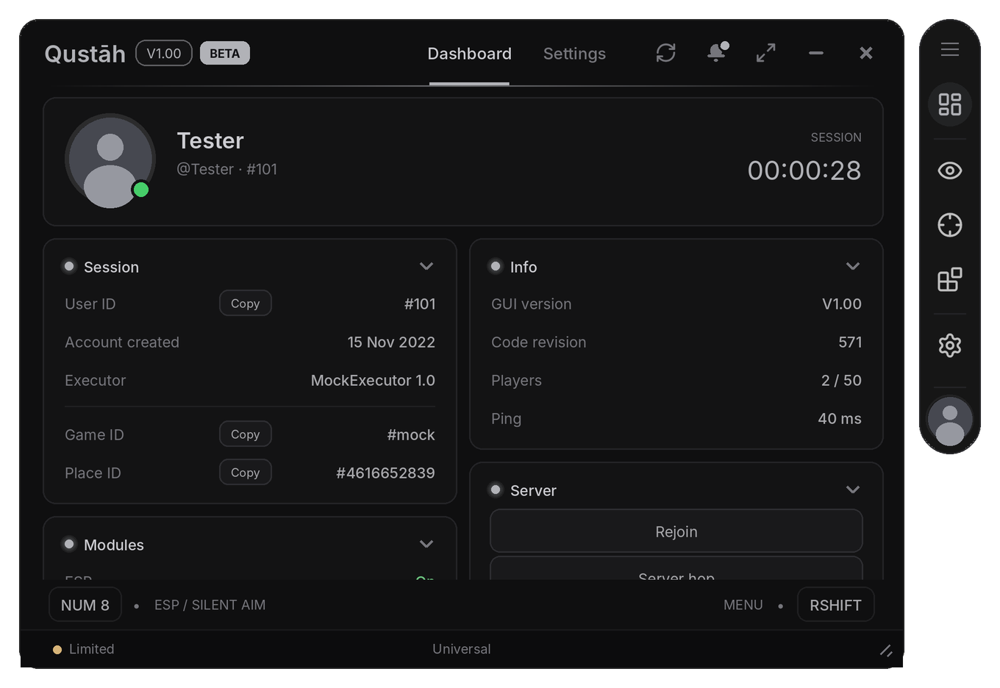<br><sub><b>Dashboard</b> (built in): profile, live chips, session, module tiles, server tools</sub></td>
<td width="50%">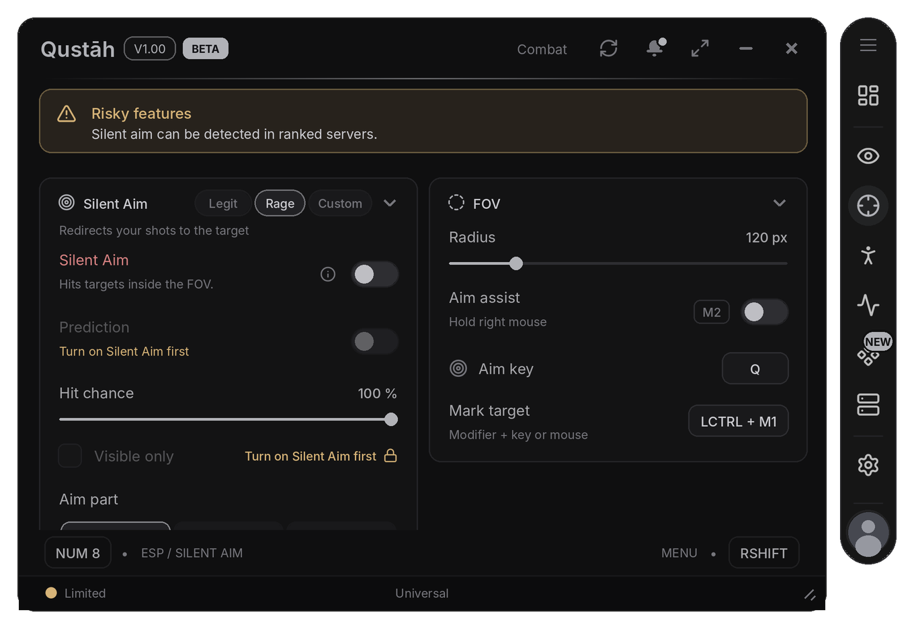<br><sub><b>Combat</b>: page warning, risky toggle, locks, presets, chord keybinds</sub></td>
</tr>
<tr>
<td width="50%">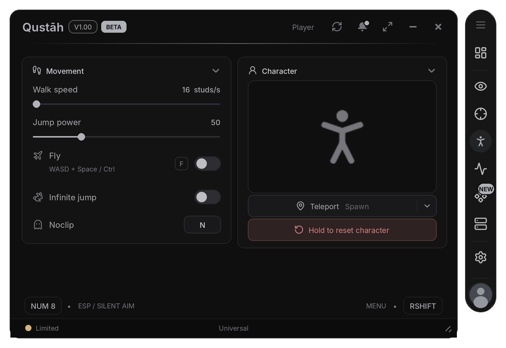<br><sub><b>Player</b>: icon rows, key caps, 3D preview, split and hold buttons</sub></td>
<td width="50%"><br><sub><b>Components › Buttons</b>: every style, cooldown, key, confirm, rows</sub></td>
</tr>
</table>

<details>
<summary><b>More screenshots</b></summary>
<br>

<table>
<tr>
<td width="50%">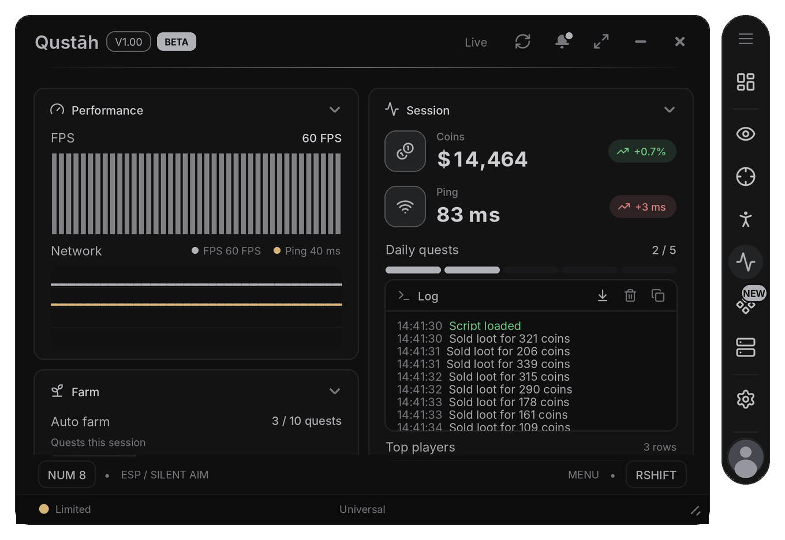<br><sub><b>Live</b>: graphs, progress, rolling stats, console, table</sub></td>
<td width="50%">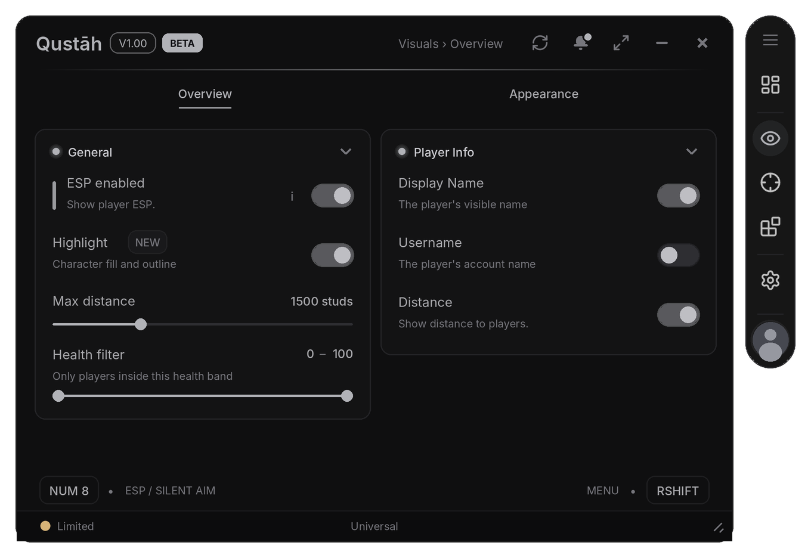<br><sub><b>Visuals</b>: page strip, bindable toggle, badge, slider, range, multi dropdown</sub></td>
</tr>
<tr>
<td width="50%">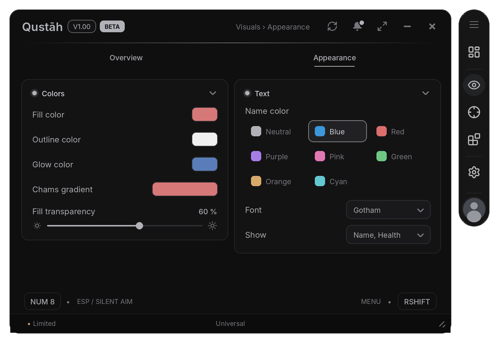<br><sub><b>Visuals › Appearance</b>: colour pickers, gradient, swatches</sub></td>
<td width="50%">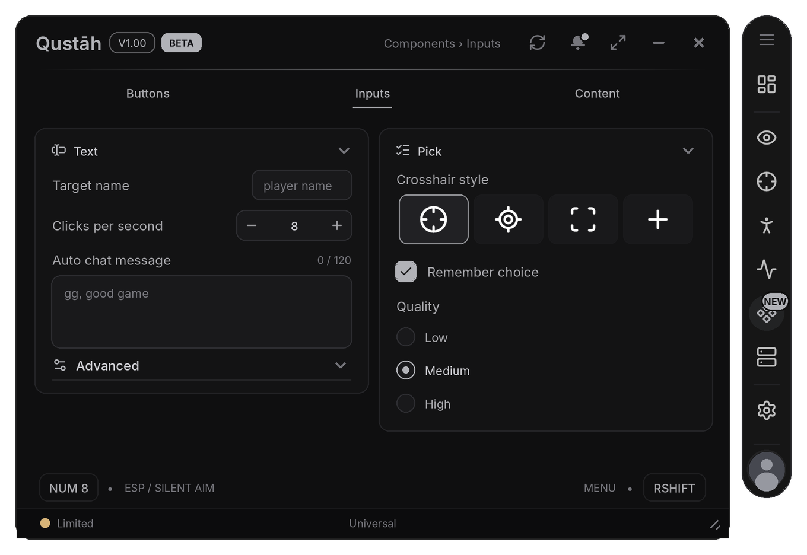<br><sub><b>Components › Inputs</b>: validation, stepper, text area, image picker, radio</sub></td>
</tr>
<tr>
<td width="50%">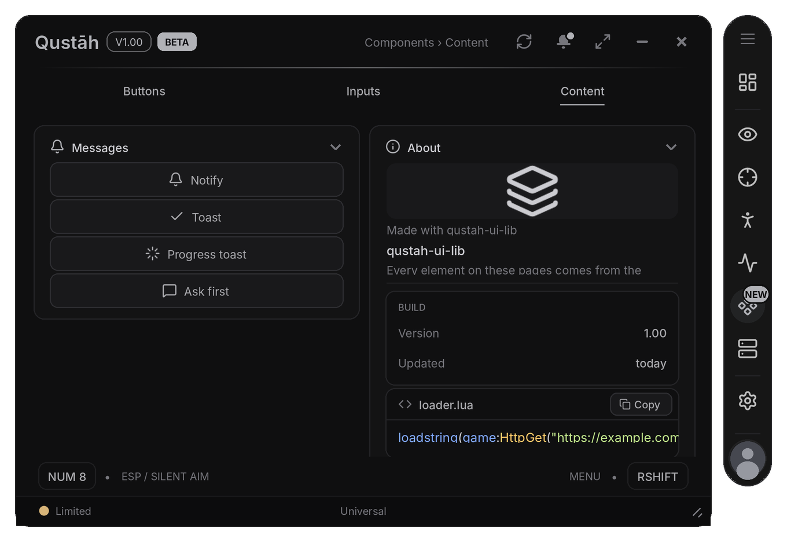<br><sub><b>Components › Content</b>: notifications, dialog, image, group, code</sub></td>
<td width="50%">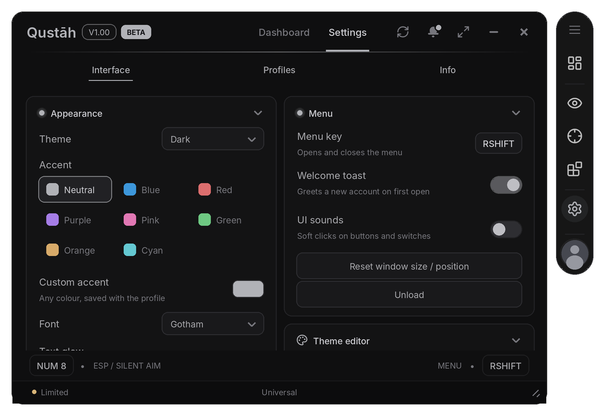<br><sub><b>Settings</b> (built in): appearance, window, behaviour, profiles, info</sub></td>
</tr>
<tr>
<td width="50%">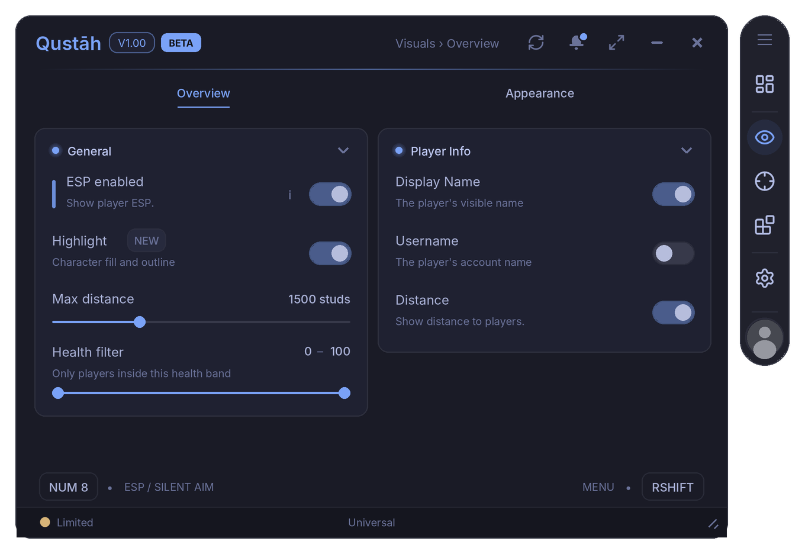<br><sub>Tokyo Night theme</sub></td>
<td width="50%">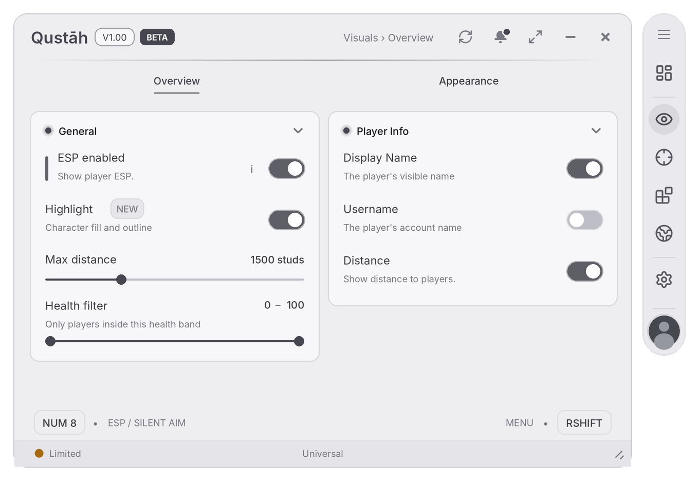<br><sub>Light theme</sub></td>
</tr>
</table>

</details>

## Elements

<table>
<tr>
<td width="20%" valign="top"><b>Switches</b><br><br><code>Toggle</code><br><code>Checkbox</code></td>
<td width="20%" valign="top"><b>Numbers</b><br><br><code>Slider</code><br><code>Range</code><br><code>Stepper</code></td>
<td width="20%" valign="top"><b>Choices</b><br><br><code>Dropdown</code><br><code>Segment</code><br><code>Radio</code></td>
<td width="20%" valign="top"><b>Colours</b><br><br><code>ColorPicker</code><br><code>Gradient</code><br><code>Swatches</code></td>
<td width="20%" valign="top"><b>Text input</b><br><br><code>Input</code><br><code>TextArea</code><br><code>ActionInput</code><br><code>Keybind</code></td>
</tr>
<tr>
<td width="20%" valign="top"><b>Buttons</b><br><br><code>Button</code></td>
<td width="20%" valign="top"><b>Text</b><br><br><code>Label</code><br><code>Paragraph</code><br><code>Info</code><br><code>Divider</code><br><code>Code</code></td>
<td width="20%" valign="top"><b>Live data</b><br><br><code>Progress</code><br><code>Stat</code><br><code>Graph</code><br><code>Console</code><br><code>Table</code></td>
<td width="20%" valign="top"><b>Visual</b><br><br><code>Image</code><br><code>ImagePicker</code><br><code>PlayerList</code><br><code>Viewport</code></td>
<td width="20%" valign="top"><b>Layout</b><br><br><code>Section</code><br><code>Row</code><br><code>Group</code><br><code>Tabs</code></td>
</tr>
</table>

Every element can be saved in profiles (Flag), depend on another one (DependsOn), show a tooltip or help hint, be locked with a reason, and flashes red if its callback errors.

## Documentation

The full reference is in **[DOCS.md](DOCS.md)**. [example.lua](example.lua) uses every element once.

| | |
|---|---|
| [**Window**](DOCS.md#window)<br><sub>Every CreateWindow option</sub> | [**Icons**](DOCS.md#icons)<br><sub>Lucide, Solar and other icon sets</sub> |
| [**Tabs, pages and cards**](DOCS.md#tabs-pages-and-cards)<br><sub>Dock tabs, page strips, two-column cards</sub> | [**Status, errors and kicks**](DOCS.md#status-errors-and-kicks)<br><sub>Module health, error list, kick log</sub> |
| [**Elements**](DOCS.md#elements)<br><sub>All 30 elements and their options</sub> | [**Window extras**](DOCS.md#window-extras)<br><sub>Header buttons, tags, phones and tablets</sub> |
| [**Flags**](DOCS.md#flags)<br><sub>Reading and setting values, reset to default</sub> | [**Key system**](DOCS.md#key-system)<br><sub>Key screen before the window opens</sub> |
| [**Notifications**](DOCS.md#notifications)<br><sub>Notifications, toasts, progress toasts</sub> | [**Tour**](DOCS.md#tour)<br><sub>First-run guide</sub> |
| [**Dialogs**](DOCS.md#dialogs)<br><sub>Dialogs and confirms</sub> | [**Changelog**](DOCS.md#changelog)<br><sub>"What's new" and version history</sub> |
| [**Configs and profiles**](DOCS.md#configs-and-profiles)<br><sub>Saving, autoload, share codes, your own data</sub> | [**Links**](DOCS.md#links)<br><sub>Discord and other link buttons</sub> |
| [**Built-in tabs**](DOCS.md#built-in-tabs)<br><sub>Dashboard and Settings</sub> | [**Secure mode**](DOCS.md#secure-mode)<br><sub>Random GUI names, silent console</sub> |
| [**Overlays**](DOCS.md#overlays)<br><sub>Watermark, keybind list, session bar, key hints</sub> | [**Development**](DOCS.md#development)<br><sub>Project layout, build, autocomplete types</sub> |
| [**Themes**](DOCS.md#themes)<br><sub>20 themes, custom themes, theme codes</sub> |  |

<br>

<div align="center">
<sub>Icons from <a href="https://github.com/Footagesus/Icons">Footagesus/Icons</a> (MIT) · made for Qustah</sub>
</div>
