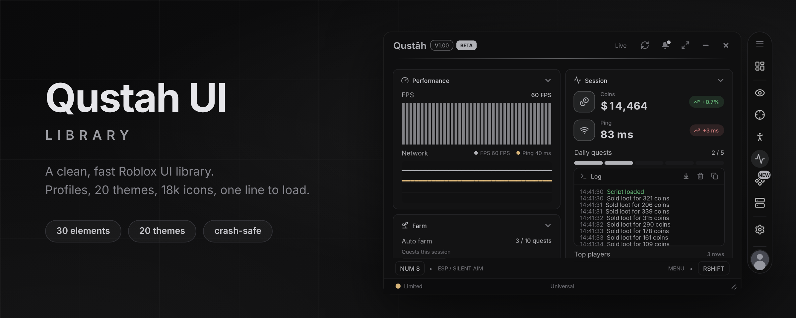
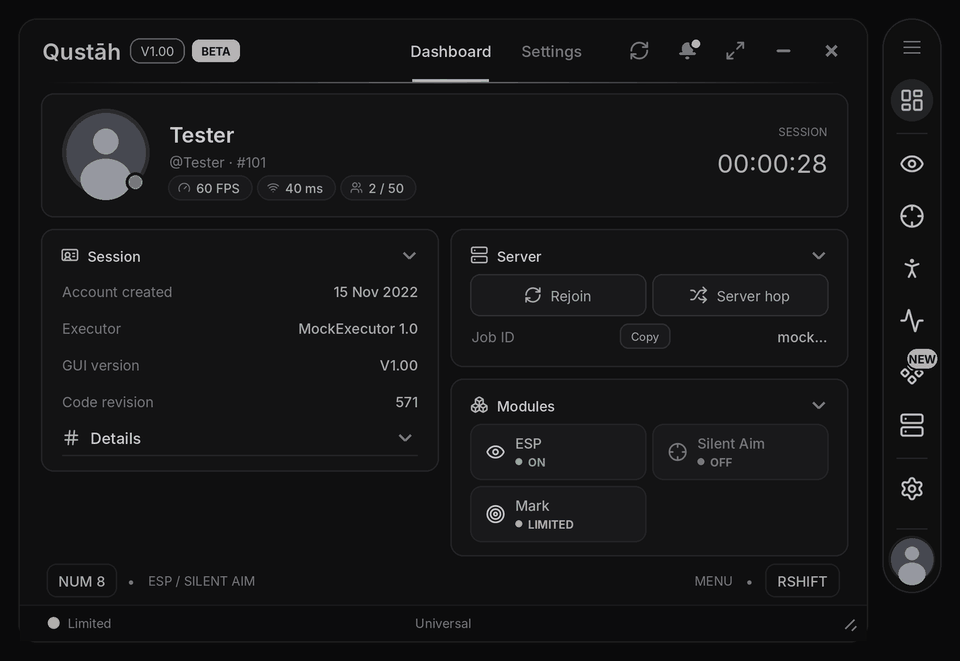
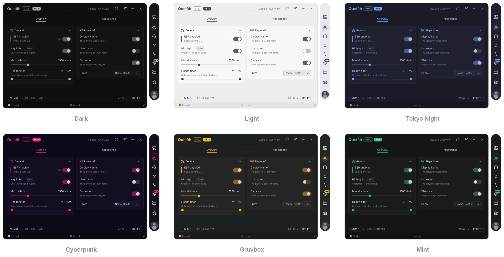

<div align="center">



**A clean, fast UI library for Roblox scripts.**<br>
Dock navigation, real profiles, 20 themes and 18k icons, loaded with one line.

<br>


[Install](#install) · [Quick start](#quick-start) · [Showcase](#showcase) · [Documentation](#documentation) · [Example](example.lua) · [License](LICENSE)

</div>

## Features

- **Finished look.** Dock, two-column cards, footer bar, key hints and smooth animations.
- **Real profiles.** Save, autoload, share codes and per-game lists. An interrupted save never damages a profile.
- **20 themes.** Tokyo Night, Cyberpunk, Gruvbox, Mint and more, all contrast-checked. Make your own and share it as a code.
- **18k icons.** Write an icon's name anywhere (`"eye"`, `"solar:target-bold"`). Lucide is built in.
- **Hard to break.** A callback error flashes the element red and is listed; the UI keeps working.
- **Ready to ship.** One line adds a Dashboard and a full Settings tab. Key system, tour, "What's new" and autocomplete types included.

## Install

```lua
local Lib = loadstring(game:HttpGet("https://raw.githubusercontent.com/79650/gwanjkcdsjawbdnjascdas-ui-lib/refs/heads/main/qustah-ui-lib/dist/qustah-ui-lib.lua"))()
```

<sub>The minified build is the same code and about 25% smaller: replace <code>qustah-ui-lib.lua</code> with <code>qustah-ui-lib.min.lua</code>.</sub>

## Quick start

```lua
local Window = Lib:CreateWindow({ Title = "Qustāh", Version = "V1.00", Folder = "Qustah" })
Window:DashboardTab()         -- first tab: profile, session, modules, server tools

local Main = Window:Tab({ Title = "Main", Icon = "eye" }):Card({ Title = "General" })
Main:Toggle({ Title = "ESP", Flag = "esp", Default = true, Callback = function(on) print(on) end })
Main:Slider({ Title = "Distance", Flag = "range", Min = 100, Max = 5000, Default = 1500, Suffix = "studs" })

Window:SettingsTab()          -- theme, font, menu key, profiles...
Window.Config:LoadAutoLoad()  -- loads the profile marked as autoload
```

## Showcase

<p align="center"></p>

### Themes

<p align="center"></p>

<p align="center"><sub>6 of the 20 built-in themes. You can also make your own and share it as a code.</sub></p>

## Documentation

Every option, with code, is in **[DOCS.md](DOCS.md)**. **[example.lua](example.lua)** builds the window in the GIF and uses every element once.

### Elements

<table>
<tr>
<td width="20%" valign="top"><b>Switches</b><br><br>Toggle<br>Checkbox</td>
<td width="20%" valign="top"><b>Numbers</b><br><br>Slider<br>Range<br>Stepper</td>
<td width="20%" valign="top"><b>Choices</b><br><br>Dropdown<br>Segment<br>Radio</td>
<td width="20%" valign="top"><b>Colours</b><br><br>ColorPicker<br>Gradient<br>Swatches</td>
<td width="20%" valign="top"><b>Text input</b><br><br>Input<br>TextArea<br>ActionInput<br>Keybind</td>
</tr>
<tr>
<td width="20%" valign="top"><b>Buttons</b><br><br>Button</td>
<td width="20%" valign="top"><b>Text</b><br><br>Label<br>Paragraph<br>Info<br>Divider<br>Code</td>
<td width="20%" valign="top"><b>Live data</b><br><br>Progress<br>Stat<br>Graph<br>Console<br>Table</td>
<td width="20%" valign="top"><b>Visual</b><br><br>Image<br>ImagePicker<br>PlayerList<br>Viewport</td>
<td width="20%" valign="top"><b>Layout</b><br><br>Section<br>Row<br>Group<br>Tabs</td>
</tr>
</table>

<sub>Every element can be saved in profiles, depend on another element, show a tooltip or help hint, be locked with a reason, and flashes red when its callback errors.</sub>

### Guides

<table>
<tr>
<td width="20%" valign="top"><b>Build</b><br><br><a href="DOCS.md#window">Window</a><br><a href="DOCS.md#tabs-pages-and-cards">Tabs, pages and cards</a><br><a href="DOCS.md#elements">Elements</a><br><a href="DOCS.md#flags">Flags</a></td>
<td width="20%" valign="top"><b>Talk to the user</b><br><br><a href="DOCS.md#notifications">Notifications</a><br><a href="DOCS.md#dialogs">Dialogs</a><br><a href="DOCS.md#tour">Tour</a><br><a href="DOCS.md#changelog">Changelog</a></td>
<td width="20%" valign="top"><b>Save and style</b><br><br><a href="DOCS.md#configs-and-profiles">Configs and profiles</a><br><a href="DOCS.md#themes">Themes</a><br><a href="DOCS.md#icons">Icons</a></td>
<td width="20%" valign="top"><b>Built in</b><br><br><a href="DOCS.md#built-in-tabs">Dashboard and Settings</a><br><a href="DOCS.md#overlays">Overlays</a><br><a href="DOCS.md#window-extras">Window extras</a><br><a href="DOCS.md#links">Links</a></td>
<td width="20%" valign="top"><b>Ship it</b><br><br><a href="DOCS.md#status-errors-and-kicks">Status, errors and kicks</a><br><a href="DOCS.md#key-system">Key system</a><br><a href="DOCS.md#secure-mode">Secure mode</a><br><a href="DOCS.md#development">Development</a></td>
</tr>
</table>
